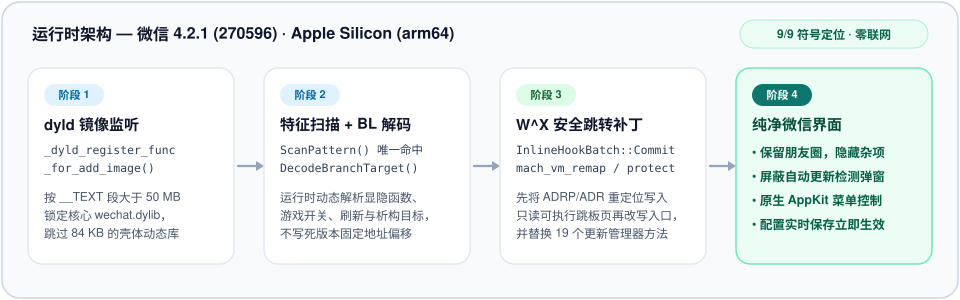
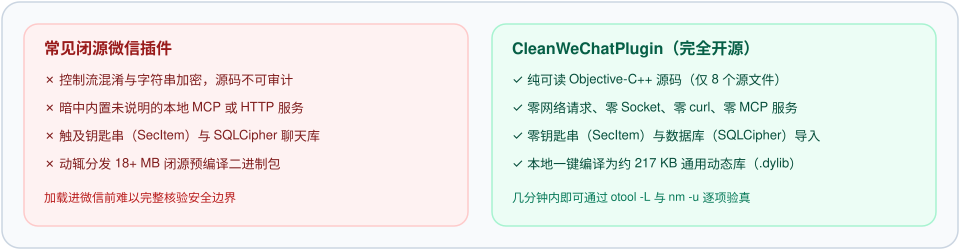

<p align="center"></p>

<p align="center"><b>开源、零混淆的 macOS 微信界面精简插件，使用纯 Objective-C++ 从源码直接编译。</b></p>

<p align="center">
  <b>完全开源</b>&nbsp;&nbsp;·&nbsp;&nbsp;<b>零联网与钥匙串访问</b>&nbsp;&nbsp;·&nbsp;&nbsp;<b>Apple Silicon (arm64)</b>
</p>

<p align="center">
  <a href="#快速开始"></a>
  <a href="#核心功能"></a>
  <a href="SECURITY.md"></a>
  <a href="LICENSE"></a>
</p>

<p align="center">
  <a href="#项目架构与文件"></a>
</p>

<p align="center"></p>

- **每一行都可审计。** 使用纯可读 Objective-C++ 编写（仅 8 个源文件），编出的通用 `.dylib` 约 217 KB，无控制流混淆、无加密字符串、无闭源第三方 Hook 库。
- **职责极度克制。** 零网络请求、零钥匙串（`SecItem`）访问、零 SQLCipher 数据库读取，也不内置任何后台 MCP 或 HTTP 服务。
- **原生菜单即时生效。** 在顶部菜单栏挂载原生 AppKit「极简微信」菜单，依托 `NSUserDefaults` 持久化开关并支持实时刷新侧边栏与发现页。

## 核心功能

### 侧边栏与发现页精简：保留朋友圈，隐藏冗余入口

插件通过 `_dyld_register_func_for_add_image` 监听镜像加载，按 `__TEXT,__text > 50 MB` 精准锁定真正的 `Contents/Resources/wechat.dylib`（自动跳过 84 KB 的 `Frameworks/wechat.dylib` 壳体库），并通过唯一 ARM64 字节特征扫描与 `BL` 指令目标解码在运行时动态定位目标函数，避免依赖版本硬编码地址偏移。

<details>
<summary><b>入口映射：</b>已核验的 <code>wechat.dylib</code> 功能键值、界面控件与 <code>NSUserDefaults</code> 开关</summary>

<table>
  <tr>
    <th align="left" width="2200">界面区域与入口</th>
    <th align="center" width="1600">内部键值 / Tab ID</th>
    <th align="center" width="1400">默认状态</th>
    <th align="left" width="3800"><code>NSUserDefaults</code> 键名</th>
  </tr>
  <tr><td>侧边栏 · 视频号</td><td align="center">Key <code>6</code> / Tab <code>3</code></td><td align="center">默认隐藏 (<code>YES</code>)</td><td><code>CleanWeChat_HideSidebarChannels</code></td></tr>
  <tr><td>侧边栏 · 搜一搜</td><td align="center">Key <code>8</code> / Tab <code>5</code></td><td align="center">默认隐藏 (<code>YES</code>)</td><td><code>CleanWeChat_HideSidebarSearch</code></td></tr>
  <tr><td>侧边栏 · 游戏</td><td align="center"><code>IsGameEnabled</code>（按调用方）</td><td align="center">默认隐藏 (<code>YES</code>)</td><td><code>CleanWeChat_HideSidebarGame</code></td></tr>
  <tr><td>侧边栏 · 小程序</td><td align="center">Key <code>5</code> / Tab <code>6</code></td><td align="center">默认隐藏 (<code>YES</code>)</td><td><code>CleanWeChat_HideSidebarMiniProgram</code></td></tr>
  <tr><td>侧边栏 · 朋友圈</td><td align="center">Key <code>9</code> / Tab <code>2</code></td><td align="center">默认显示 (<code>NO</code>)</td><td><code>CleanWeChat_HideSidebarMoments</code></td></tr>
  <tr><td>侧边栏 · 发现入口图标</td><td align="center">主栏 Tab <code>3</code></td><td align="center">默认显示 (<code>NO</code>)</td><td><code>CleanWeChat_HideSidebarDiscover</code></td></tr>
  <tr><td>侧边栏 · 更多（…）</td><td align="center">扩展栏 Tab <code>8</code></td><td align="center">默认显示 (<code>NO</code>)</td><td><code>CleanWeChat_HideSidebarMore</code></td></tr>
  <tr><td>发现页 · 视频号</td><td align="center">Key <code>6</code></td><td align="center">默认隐藏 (<code>YES</code>)</td><td><code>CleanWeChat_HideDiscoverChannels</code></td></tr>
  <tr><td>发现页 · 搜一搜</td><td align="center">Key <code>8</code></td><td align="center">默认隐藏 (<code>YES</code>)</td><td><code>CleanWeChat_HideDiscoverSearch</code></td></tr>
  <tr><td>发现页 · 游戏</td><td align="center"><code>IsGameEnabled</code>（按调用方）</td><td align="center">默认隐藏 (<code>YES</code>)</td><td><code>CleanWeChat_HideDiscoverGame</code></td></tr>
  <tr><td>发现页 · 小程序</td><td align="center">Key <code>5</code></td><td align="center">默认隐藏 (<code>YES</code>)</td><td><code>CleanWeChat_HideDiscoverMiniProgram</code></td></tr>
  <tr><td>发现页 · 朋友圈</td><td align="center">Key <code>9</code></td><td align="center">默认显示 (<code>NO</code>)</td><td><code>CleanWeChat_HideDiscoverMoments</code></td></tr>
</table>

<sub>微信 <code>4.2.1 (270596)</code> 实测解析符号：<code>DiscoverModelBuildItems</code> (<code>0xd72268</code>)、<code>DiscoverModelRefresh</code> (<code>0xd76280</code>)、<code>DiscoverModel::~DiscoverModel</code> (<code>0xd72768</code>)、<code>SidebarRefreshVisibility</code> (<code>0xf8d124</code>)、<code>SidebarController::~SidebarController</code> (<code>0xf8d9b0</code>)、<code>ShouldShowDiscover</code> (<code>0x1a56fc0</code>)、<code>ShouldShowSidebar</code> (<code>0x1a572d8</code>)、<code>IsGameEnabled</code> (<code>0x19ced38</code>) 与 <code>XTabBarGetItem</code> (<code>0x1d53fd8</code>)。</sub>

</details>

### 屏蔽微信自动更新：原生拦截 XAppUpdateManager

直接调用 Objective-C Runtime 的 `class_getInstanceMethod` 与 `method_setImplementation` 拦截 `XAppUpdateManager` 的启动检测、横幅提示与安装触发方法，同时保留原始 `IMP` 指针；当 `CleanWeChat_DisableAutoUpdate` 为 `YES` 时彻底静默 Sparkle 自动更新检查与弹窗。

<details>
<summary><b>方法清单：</b>共拦截 <code>XAppUpdateManager</code> 的 19 个选择器</summary>

<table>
  <tr>
    <th align="left" width="2600">分类</th>
    <th align="left" width="6400">Objective-C 选择器（Selectors）</th>
  </tr>
  <tr><td>更新器启动与检测</td><td><code>startUpdater</code>, <code>checkForUpdates:</code>, <code>startBackgroundUpdatesCheck:</code>, <code>enableAutoUpdate:</code>, <code>setAutomaticallyChecksForUpdatesIfNeeded:</code></td></tr>
  <tr><td>策略 Setter 强制置为 <code>NO</code></td><td><code>setAutomaticallyDownloadsUpdates:</code>, <code>setCanCheckForUpdate:</code>, <code>setShouldAlertUserForUpdate:</code>, <code>setShouldShowTipsBanner:</code></td></tr>
  <tr><td>状态 Getter 强制返回 <code>NO</code></td><td><code>automaticallyDownloadsUpdates</code>, <code>canCheckForUpdate</code>, <code>shouldAlertUserForUpdate</code>, <code>shouldShowTipsBanner</code>, <code>isUpdateReady</code></td></tr>
  <tr><td>安装流程与 Sparkle 回调</td><td><code>quitAndInstallIfNeeded:</code>, <code>quitAndInstallIfNeeded:extraInfo:</code>, <code>updater:shouldProceedWithUpdate:updateCheck:error:</code>, <code>updater:didFindValidUpdate:</code>, <code>evaluateShouldShowTipsBanner</code></td></tr>
</table>

</details>

### 零闭源依赖的 ARM64 Hook 引擎

<a href="SECURITY.md"></a>

[Arm64Hook.mm](src/Arm64Hook.mm) 内置轻量级 `InlineHookBatch`：先把目标函数前 4 条指令（自动将 `ADRP`/`ADR` 重定位为绝对 `MOVZ`/`MOVK` 指令序列）写入匿名跳板页，再通过 `mach_vm_protect` 切换页权限为 `VM_PROT_READ | VM_PROT_EXECUTE` 并刷新指令缓存，最后才通过 `mach_vm_protect` / `mach_vm_remap` 写入 16 字节绝对跳转指令，严格遵循 Apple Silicon W^X 内存安全规范。

<details>
<summary><b>产物审计：</b><code>build/libCleanWeChat.dylib</code> 的链接库与外部导入符号实测</summary>

```text
$ otool -L build/libCleanWeChat.dylib
	@executable_path/../Frameworks/libCleanWeChat.dylib
	/System/Library/Frameworks/Cocoa.framework/Versions/A/Cocoa
	/System/Library/Frameworks/Foundation.framework/Versions/C/Foundation
	/usr/lib/libobjc.A.dylib
	/usr/lib/libc++.1.dylib
	/usr/lib/libSystem.B.dylib
	/System/Library/Frameworks/AppKit.framework/Versions/C/AppKit
	/System/Library/Frameworks/CoreFoundation.framework/Versions/A/CoreFoundation

$ nm -arch arm64 -u build/libCleanWeChat.dylib | grep -Ei "curl|socket|connect|NSURL|CFNetwork|SecItem|SecKeychain|sqlite|sqlcipher|dlopen|system|popen|NSTask|CGEvent|AXUIElement" || echo "零敏感导入检查通过"
零敏感导入检查通过
```

</details>

### 更多细节

- **[顶部原生菜单](src/PluginMenu.mm)：** 在 `[NSApp mainMenu]` 添加「极简微信」子菜单，通过 `NSMenuDelegate` 自动同步勾选状态，支持一键“立即刷新侧栏与发现页”和“恢复显示全部入口”。
- **[生命周期安全](src/NavigationHook.mm)：** 同时 Hook `~SidebarController` 与 `~DiscoverModel` 析构函数，在退出登录或切换账号时清空缓存的 `std::atomic<void*>` 指针，杜绝悬垂引用崩溃。
- **[明确的非目标范围](SECURITY.md)：** 不含本地 MCP/HTTP 服务、不拦截钥匙串、不读取聊天数据库；鉴于微信 `4.2.1` 朋友圈信息流涉及复杂 C++ `std::vector<std::shared_ptr<...>>` 对象布局及跨模块高频复用函数（`96` / `124` 处调用），朋友圈时间线广告/企业联系人过滤未纳入本仓库范围。

## 快速开始

### 方式一：本地编译并运行自检

需先安装 Xcode Command Line Tools（提供 `clang++` 与 `codesign`），适用于 macOS（`12.0+`，已在 Apple Silicon macOS `26.6.2` 及微信 `4.2.1 / 270596` 环境下实测编译并完成 9/9 符号验证）。

```bash
git clone https://github.com/XiaKaiYang/CleanWeChatPlugin.git
cd CleanWeChatPlugin
./build.sh
```

脚本会在 `-Wall -Wextra -Werror` 下编译通用二进制 `build/libCleanWeChat.dylib`（约 217 KB），运行单元测试，并在本机存在 `/Applications/WeChat.app/Contents/Resources/wechat.dylib` 时执行只读特征验真：

```text
微信 4.2.1 特征验真通过（已解析 9/9 个目标符号）
全部单元测试通过
编译完成：.../build/libCleanWeChat.dylib
```

### 方式二：独立审计编译产物

运行前可自行校验动态库链接的所有系统框架、外部未定义符号及代码签名：

```bash
otool -L build/libCleanWeChat.dylib
nm -arch arm64 -u build/libCleanWeChat.dylib
codesign --verify --strict --verbose=2 build/libCleanWeChat.dylib
```

### 方式三：本地加载说明（Apple Silicon）

本仓库仅提供干净可审计的插件源码与自检工具，不捆绑闭源二进制注入程序。如需本地加载您自行编译的 `.dylib`：

1. 操作前请务必先备份官方原版 `/Applications/WeChat.app`。
2. 将自己编出的 `build/libCleanWeChat.dylib` 复制至 `WeChat.app/Contents/Frameworks/libCleanWeChat.dylib`。
3. 在 `WeChat.app/Contents/MacOS/WeChat` 中添加或替换加载命令 `@executable_path/../Frameworks/libCleanWeChat.dylib`（若替换已有加载条目可使用 `install_name_tool -change`），先用 `codesign -d --entitlements :-` 导出并保留微信原有 entitlements，再执行本地 ad-hoc 重签（`codesign -f -s - --entitlements entitlements.plist`）；如遇 Team ID 校验拦截，需对 `Contents/Resources/wechat.dylib` 一并做本地 ad-hoc 重签。
4. 若外部分发拷贝触发系统隔离属性拦截，可移除 quarantine 属性：

```bash
xattr -dr com.apple.quarantine /Applications/WeChat.app
```

请注意：重签 `/Applications/WeChat.app` 会将腾讯官方签名转为本地 ad-hoc 签名，macOS 会将其识别为不同签名主体，部分钥匙串或系统权限弹窗行为可能随之改变。

## 项目架构与文件

<table>
  <tr>
    <th width="260" align="left">文件</th>
    <th width="640" align="left">职责说明</th>
  </tr>
  <tr>
    <td><a href="src/Arm64Hook.hpp"><code>src/Arm64Hook.{hpp,mm}</code></a></td>
    <td>Mach-O <code>__TEXT,__text</code> 解析、唯一特征扫描、<code>BL</code> 目标解码、<code>ADRP</code>/<code>ADR</code> 跳板重定位及 W^X 内存补丁。</td>
  </tr>
  <tr>
    <td><a href="src/NavigationHook.mm"><code>src/NavigationHook.mm</code></a></td>
    <td>监听 <code>Resources/wechat.dylib</code> 加载，Hook 侧边栏/发现页显隐控制、游戏入口开关、界面刷新与析构清理。</td>
  </tr>
  <tr>
    <td><a href="src/UpdateHook.mm"><code>src/UpdateHook.mm</code></a></td>
    <td>使用 Objective-C Runtime 拦截 <code>XAppUpdateManager</code> 的 19 个更新相关方法。</td>
  </tr>
  <tr>
    <td><a href="src/PluginMenu.mm"><code>src/PluginMenu.mm</code></a></td>
    <td>在 <code>[NSApp mainMenu]</code> 添加「极简微信」原生菜单，配合 <code>NSMenuDelegate</code> 同步开关并触发界面实时刷新。</td>
  </tr>
  <tr>
    <td><a href="src/PluginConfig.mm"><code>src/PluginConfig.{h,mm}</code></a></td>
    <td>默认开关注册及全部 <code>CleanWeChat_*</code> 键值的 <code>NSUserDefaults</code> 持久化读写。</td>
  </tr>
  <tr>
    <td><a href="src/CleanWeChatEntry.mm"><code>src/CleanWeChatEntry.mm</code></a></td>
    <td><code>__attribute__((constructor))</code> 动态库入口，在 <code>arm64</code> 下完成全部模块初始化。</td>
  </tr>
  <tr>
    <td><a href="tests/test_hook.mm"><code>tests/test_hook.mm</code></a></td>
    <td>ARM64 活体 Hook 单元测试 + 对本机微信 <code>4.2.1</code> 9/9 目标符号的只读验证。</td>
  </tr>
  <tr>
    <td><a href="build.sh"><code>build.sh</code></a></td>
    <td>一键编译通用 <code>.dylib</code>、执行 ad-hoc 签名并运行完整自检测试。</td>
  </tr>
</table>

## 安全与反馈

- [安全策略与审计指南](SECURITY.md)：查看本项目的安全边界说明与逐项验真命令。
- [GitHub Issues](https://github.com/XiaKaiYang/CleanWeChatPlugin/issues)：提交新版本微信兼容性适配需求、Bug 反馈或功能建议。

## 致谢

- 完全基于苹果官方系统框架（`Cocoa`、`Foundation`、`AppKit`、`libobjc`、`dyld`、`Mach VM`）构建，不依赖任何第三方闭源运行时库。
- 致敬简洁透明的 macOS 工程实践与单职责桌面小工具设计理念。

## Star 趋势

<a href="https://www.star-history.com/#XiaKaiYang/CleanWeChatPlugin&type=date&legend=top-left">
  <picture>
    <source media="(prefers-color-scheme: dark)" srcset="https://api.star-history.com/svg?repos=XiaKaiYang%2FCleanWeChatPlugin&type=date&theme=dark&legend=top-left" />
    <source media="(prefers-color-scheme: light)" srcset="https://api.star-history.com/svg?repos=XiaKaiYang%2FCleanWeChatPlugin&type=date&legend=top-left" />
    
  </picture>
</a>

## 开源协议

本项目基于 [MIT License](LICENSE) 开源。请严格遵守相关软件使用条款与当地法律法规，仅限用于个人桌面界面精简与安全技术研究。
